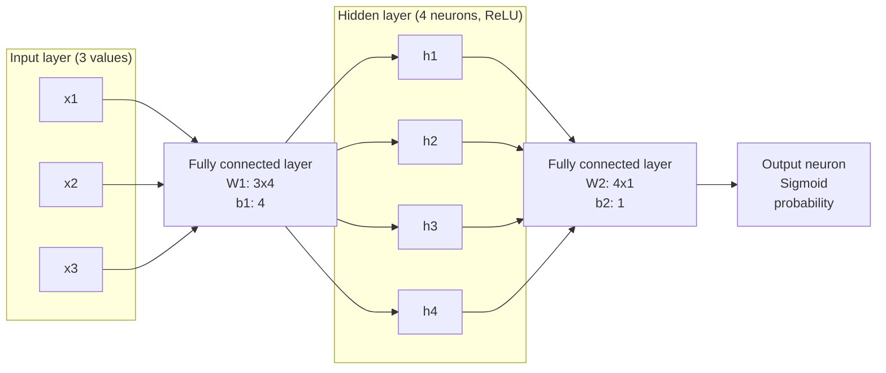

# Network diagram

The input vector has 3 values. The first fully connected layer maps 3 inputs to
4 hidden neurons using `W1` and `b1`; ReLU is applied to those 4 values. The
second layer maps the 4 hidden values to 1 output using `W2` and `b2`; Sigmoid
converts that value to an output probability.
