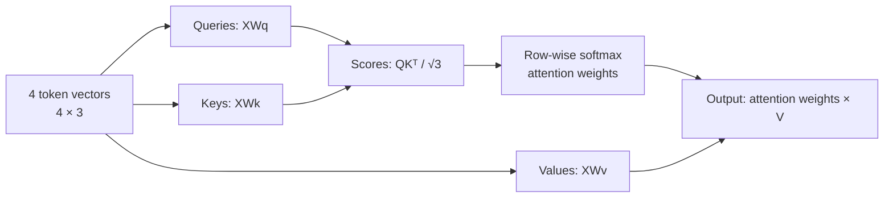

# W2_D2_T1: Self-Attention from Scratch

Run `python self_attention.py` to reproduce the calculations using NumPy.
The script creates four 3D token vectors and three 3x3 projection matrices
after setting `np.random.seed(0)`. It computes Q, K, V, scaled dot-product
scores, row-wise softmax attention weights, and the weighted value output.
It also prints each row sum and asserts that all four rows sum to 1.

## Attention weight matrix

```text
[[0.2445 0.2173 0.3457 0.1925]
 [0.2442 0.2171 0.3434 0.1953]
 [0.2412 0.2086 0.3742 0.1760]
 [0.2467 0.2239 0.3301 0.1994]]
```

Each row sums to 1 (within floating-point precision), because softmax is
applied across the four key scores for each query token.

## Query, Key, and Value (5 lines)

1. In a library, a **Query** is like the topic you are searching for right now.
2. Each book's **Key** is its catalog information, used to judge how relevant it is to that query.
3. The query-key comparison gives each book a relevance score.
4. A book's **Value** is the actual information that could be useful if the book is relevant.
5. Attention combines the values, giving more influence to books with higher relevance scores.

## Self-attention data flow


