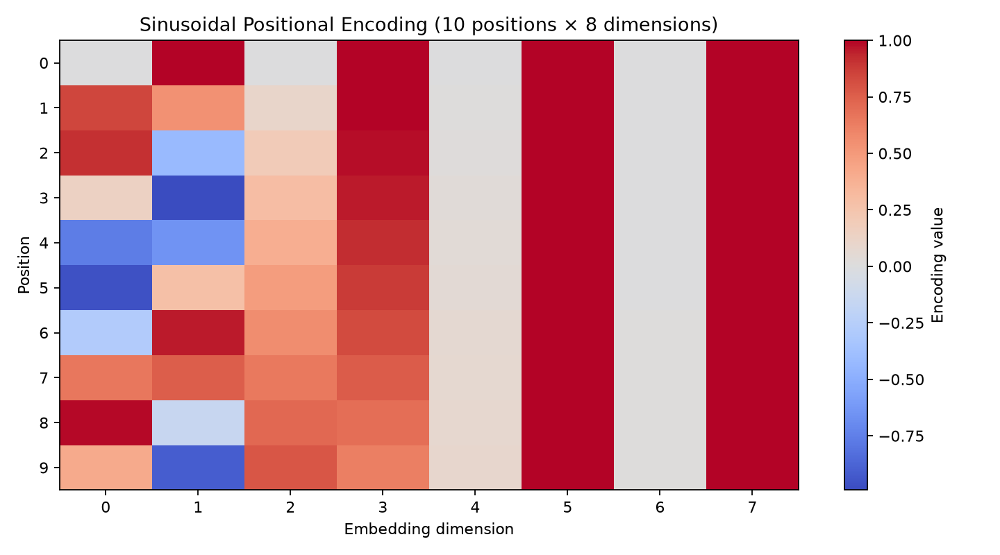

# Encoder vs Decoder and Positional Encoding

## Encoder-only vs decoder-only

| Aspect | Encoder-only (BERT-style) | Decoder-only (GPT-style) |
|---|---|---|
| How it reads | Uses self-attention over both left and right context in the input | Uses causal self-attention over preceding tokens only |
| What it outputs | Contextual representations; for fill-mask, scores candidate tokens at the masked position | A probability distribution for the next token, repeated to generate a continuation |
| Best tasks | Understanding: classification, sentiment analysis, extractive question answering, and fill-mask | Generation: text completion, drafting, summarization, and conversational responses |
| Example models | BERT, RoBERTa | GPT-2, GPT-3 |

## Sinusoidal positional encoding

The matrix contains 10 positions and 8 dimensions.
For position `pos` and pair index `k`, dimensions `2k` and `2k+1` use
`sin(pos / 10000^(2k/d))` and `cos(pos / 10000^(2k/d))`, respectively.

## Why word order needs positional encoding

Without positional encoding, self-attention has no signal for token positions.
It treats the same words in a sentence as an unordered set of representations.
So “dog bites person” and “person bites dog” can look identical to the model.
Positional information lets the model distinguish sequence order and meaning.

## Model examples

- **BERT fill-mask** (`bert-base-uncased`): `The capital of France is [MASK].` -> **paris**.
  This is useful when predicting a missing word from context on both sides.
- **GPT-2 text-generation** (`gpt2`): **Prompt:** `Once upon a time`
  **Continuation:** , the world was a place of great beauty and great danger. The world was a place of great danger, and the
  This demonstrates autoregressive text continuation, producing one token after another.
